# Performance evaluation: RL qubit routing

All methods route the same random circuits on the same chip from the same trivial initial layout. Every routed circuit passed the independent verifier (chip edges + program order).

## Headline: SWAPs relative to Qiskit SABRE

`ratio_vs_sabre` = total SWAPs / SABRE total SWAPs (below 1 = better). The CI is a 95% paired bootstrap over circuits.

| method | subset | circuits | ratio_vs_sabre | 95% CI | swaps_saved_pct | win/tie/loss |
|---|---|---|---|---|---|---|
| greedy | seen chips | 270 | 1.31 | [1.285, 1.336] | -31.0 | 10/10/250 |
| greedy | unseen chips | 120 | 1.312 | [1.275, 1.348] | -31.2 | 7/4/109 |
| greedy | all chips | 390 | 1.31 | [1.287, 1.333] | -31.0 | 17/14/359 |
| DQN | seen chips | 270 | 0.891 | [0.877, 0.906] | 10.9 | 209/30/31 |
| DQN | unseen chips | 120 | 0.885 | [0.865, 0.907] | 11.5 | 102/10/8 |
| DQN | all chips | 390 | 0.888 | [0.877, 0.901] | 11.2 | 311/40/39 |
| tabular-Q | seen chips | 30 | 0.977 | [0.902, 1.061] | 2.3 | 18/3/9 |
| tabular-Q | all chips | 30 | 0.977 | [0.903, 1.059] | 2.3 | 18/3/9 |

## 1. Training

### Double DQN

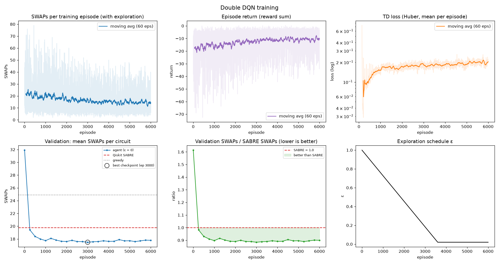

| episodes | best_episode | best_val_swaps | best_ratio_vs_sabre | final_val_swaps | final_ratio_vs_sabre | sabre_val_swaps |
|---|---|---|---|---|---|---|
| 6000 | 3000 | 17.49 | 0.884 | 17.79 | 0.899 | 19.77 |

### Tabular Q-learning

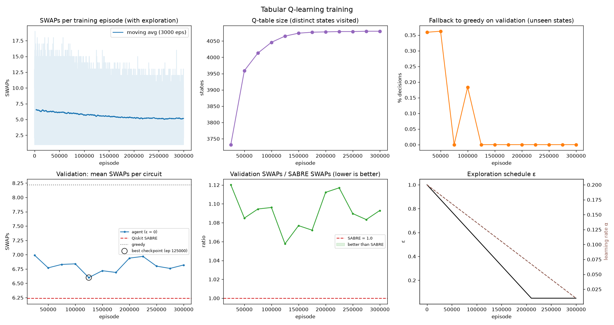

| episodes | best_episode | best_val_swaps | best_ratio_vs_sabre | final_val_swaps | final_ratio_vs_sabre | sabre_val_swaps |
|---|---|---|---|---|---|---|
| 300000 | 125000 | 6.6 | 1.058 | 6.82 | 1.093 | 6.24 |

## 2. Benchmark on held-out circuits

Test set: 30 circuits × 30 CX gates per chip, seed 12345 (different from training and validation).

| topology | seen_in_training | method | circuits | mean_swaps | mean_depth | valid_pct |
|---|---|---|---|---|---|---|
| line4 | True | SABRE | 30 | 14.2 | 63.5 | 100.0 |
| line4 | True | greedy | 30 | 17.33 | 68.03 | 100.0 |
| line4 | True | DQN | 30 | 11.8 | 58.03 | 100.0 |
| line4 | True | tabular-Q | 30 | 13.87 | 63.8 | 100.0 |
| line5 | True | SABRE | 30 | 21.37 | 75.87 | 100.0 |
| line5 | True | greedy | 30 | 28.03 | 83.27 | 100.0 |
| line5 | True | DQN | 30 | 19.33 | 70.8 | 100.0 |
| line7 | True | SABRE | 30 | 35.1 | 88.03 | 100.0 |
| line7 | True | greedy | 30 | 46.17 | 99.73 | 100.0 |
| line7 | True | DQN | 30 | 31.4 | 83.0 | 100.0 |
| ring6 | True | SABRE | 30 | 17.53 | 58.43 | 100.0 |
| ring6 | True | greedy | 30 | 24.07 | 66.13 | 100.0 |
| ring6 | True | DQN | 30 | 15.93 | 55.2 | 100.0 |
| ring8 | True | SABRE | 30 | 28.43 | 64.9 | 100.0 |
| ring8 | True | greedy | 30 | 35.97 | 72.23 | 100.0 |
| ring8 | True | DQN | 30 | 25.67 | 64.5 | 100.0 |
| grid2x3 | True | SABRE | 30 | 13.3 | 53.07 | 100.0 |
| grid2x3 | True | greedy | 30 | 18.73 | 63.73 | 100.0 |
| grid2x3 | True | DQN | 30 | 12.0 | 50.9 | 100.0 |
| grid3x3 | True | SABRE | 30 | 18.9 | 53.83 | 100.0 |
| grid3x3 | True | greedy | 30 | 28.03 | 69.5 | 100.0 |
| grid3x3 | True | DQN | 30 | 17.3 | 53.6 | 100.0 |
| star6 | True | SABRE | 30 | 11.53 | 64.6 | 100.0 |
| star6 | True | greedy | 30 | 13.9 | 71.7 | 100.0 |
| star6 | True | DQN | 30 | 10.07 | 60.2 | 100.0 |
| star8 | True | SABRE | 30 | 12.67 | 68.0 | 100.0 |
| star8 | True | greedy | 30 | 14.37 | 73.1 | 100.0 |
| star8 | True | DQN | 30 | 10.67 | 62.0 | 100.0 |
| line10 | False | SABRE | 30 | 55.97 | 102.27 | 100.0 |
| line10 | False | greedy | 30 | 73.8 | 125.0 | 100.0 |
| line10 | False | DQN | 30 | 49.8 | 105.57 | 100.0 |
| ring10 | False | SABRE | 30 | 38.4 | 73.13 | 100.0 |
| ring10 | False | greedy | 30 | 52.13 | 84.7 | 100.0 |
| ring10 | False | DQN | 30 | 34.83 | 72.53 | 100.0 |
| grid3x4 | False | SABRE | 30 | 25.93 | 60.5 | 100.0 |
| grid3x4 | False | greedy | 30 | 34.5 | 71.87 | 100.0 |
| grid3x4 | False | DQN | 30 | 22.33 | 57.77 | 100.0 |
| star10 | False | SABRE | 30 | 13.53 | 70.6 | 100.0 |
| star10 | False | greedy | 30 | 15.1 | 75.3 | 100.0 |
| star10 | False | DQN | 30 | 11.47 | 64.4 | 100.0 |

### Ratio to SABRE with confidence intervals

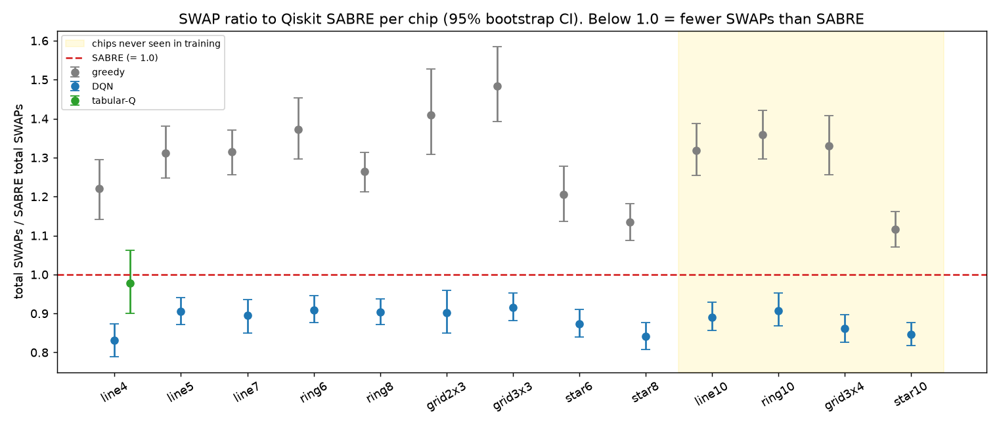

| topology | method | seen | ratio | ci_low | ci_high | mean_saved_pct |
|---|---|---|---|---|---|---|
| line4 | greedy | True | 1.221 | 1.141 | 1.294 | -23.3 |
| line4 | DQN | True | 0.831 | 0.789 | 0.874 | 16.2 |
| line4 | tabular-Q | True | 0.977 | 0.9 | 1.062 | 1.0 |
| line5 | greedy | True | 1.312 | 1.247 | 1.38 | -32.2 |
| line5 | DQN | True | 0.905 | 0.872 | 0.941 | 9.0 |
| line7 | greedy | True | 1.315 | 1.256 | 1.371 | -32.3 |
| line7 | DQN | True | 0.895 | 0.85 | 0.935 | 9.8 |
| ring6 | greedy | True | 1.373 | 1.297 | 1.454 | -40.3 |
| ring6 | DQN | True | 0.909 | 0.877 | 0.946 | 8.0 |
| ring8 | greedy | True | 1.265 | 1.213 | 1.313 | -26.9 |
| ring8 | DQN | True | 0.903 | 0.871 | 0.937 | 8.8 |
| grid2x3 | greedy | True | 1.409 | 1.308 | 1.527 | -43.4 |
| grid2x3 | DQN | True | 0.902 | 0.85 | 0.96 | 9.0 |
| grid3x3 | greedy | True | 1.483 | 1.393 | 1.585 | -50.1 |
| grid3x3 | DQN | True | 0.915 | 0.881 | 0.953 | 8.1 |
| star6 | greedy | True | 1.205 | 1.136 | 1.278 | -22.6 |
| star6 | DQN | True | 0.873 | 0.839 | 0.91 | 11.9 |
| star8 | greedy | True | 1.134 | 1.087 | 1.181 | -13.5 |
| star8 | DQN | True | 0.842 | 0.807 | 0.876 | 15.5 |
| line10 | greedy | False | 1.319 | 1.255 | 1.388 | -32.7 |
| line10 | DQN | False | 0.89 | 0.856 | 0.929 | 10.4 |
| ring10 | greedy | False | 1.358 | 1.297 | 1.422 | -37.1 |
| ring10 | DQN | False | 0.907 | 0.869 | 0.952 | 8.7 |
| grid3x4 | greedy | False | 1.33 | 1.256 | 1.407 | -34.5 |
| grid3x4 | DQN | False | 0.861 | 0.826 | 0.897 | 13.5 |
| star10 | greedy | False | 1.116 | 1.07 | 1.161 | -12.4 |
| star10 | DQN | False | 0.847 | 0.818 | 0.877 | 14.8 |

### Mean SWAPs and per-circuit scatter

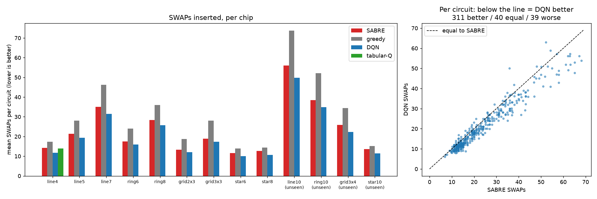

### Per-circuit distribution

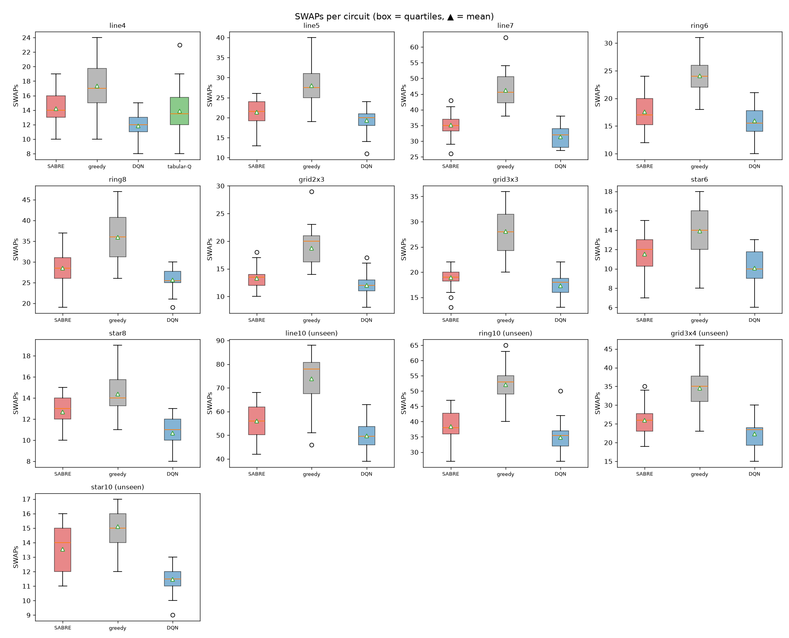

### Win / tie / loss vs SABRE

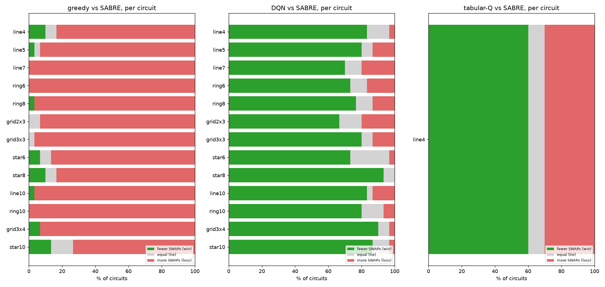

### Per-circuit improvement

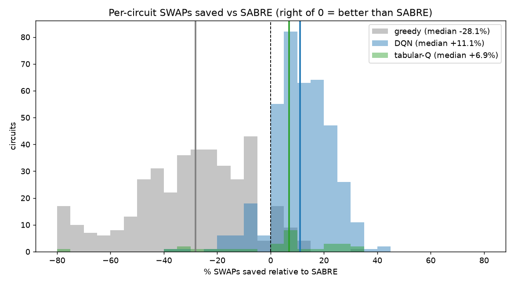

### Circuit depth

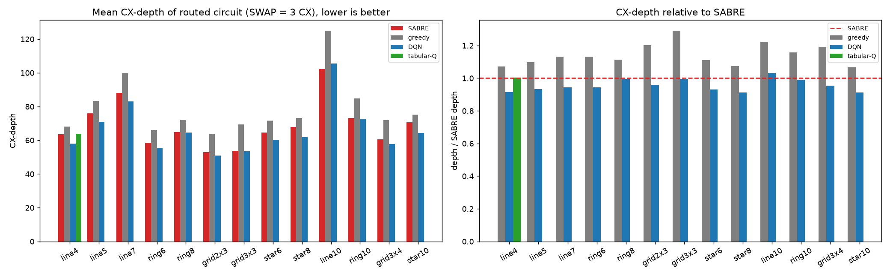

### Runtime

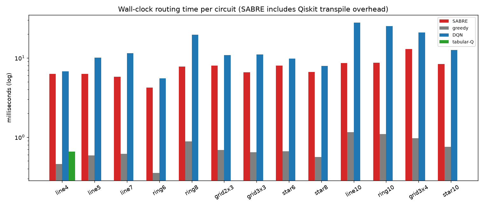

### Estimated fidelity (p = 0.01 per CX)

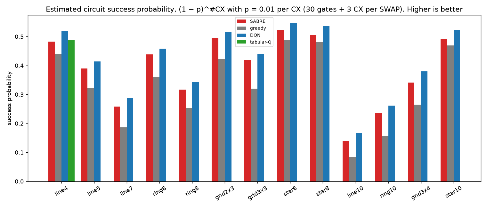

Fewer SWAPs means fewer noisy CX gates. This is a simple uniform-error model meant to show the practical effect, not a hardware-calibrated simulation.

## 3. Generalisation

### Longer circuits

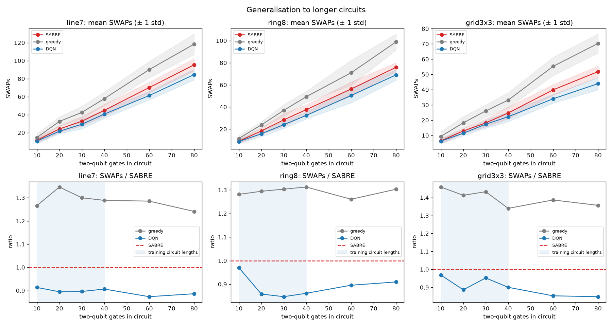

### Larger / different chips

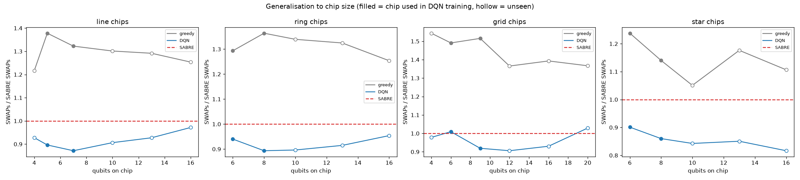

## 4. What the agent learned (decision analysis)

A greedy router always serves the closest waiting gate. `non_closest_pct` is how often the agent deliberately serves a farther one, paying more SWAPs now to save more later. Mode shares only count gates with d > 2, where the three modes really differ.

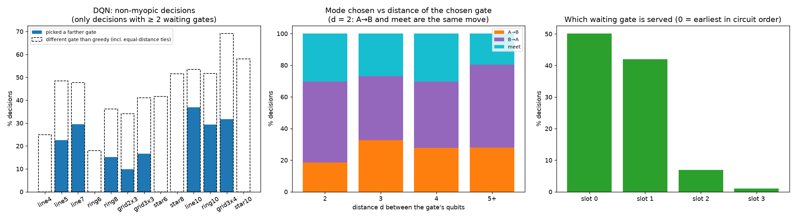

| topology | decisions | with_choice | non_closest_pct | diff_gate_from_greedy_pct | mode_A→B_pct | mode_B→A_pct | mode_meet_pct |
|---|---|---|---|---|---|---|---|
| line4 | 107 | 20 | 0.0 | 25.0 | 23.8 | 23.8 | 52.4 |
| line5 | 151 | 31 | 22.6 | 48.4 | 22.2 | 44.4 | 33.3 |
| line7 | 179 | 88 | 29.5 | 47.7 | 34.7 | 41.3 | 24.0 |
| ring6 | 151 | 61 | 0.0 | 18.0 | 50.0 | 8.3 | 41.7 |
| ring8 | 183 | 105 | 15.2 | 36.2 | 38.1 | 38.1 | 23.8 |
| grid2x3 | 111 | 41 | 9.8 | 34.1 | 30.8 | 46.2 | 23.1 |
| grid3x3 | 137 | 78 | 16.7 | 41.0 | 31.8 | 45.5 | 22.7 |
| star6 | 102 | 24 | 0.0 | 41.7 | 0.0 | 0.0 | 0.0 |
| star8 | 107 | 31 | 0.0 | 51.6 | 0.0 | 0.0 | 0.0 |
| line10 | 208 | 157 | 36.9 | 53.5 | 34.7 | 48.4 | 16.9 |
| ring10 | 204 | 147 | 29.3 | 51.7 | 27.7 | 42.6 | 29.8 |
| grid3x4 | 166 | 123 | 31.7 | 69.1 | 21.1 | 43.9 | 35.1 |
| star10 | 113 | 50 | 0.0 | 58.0 | 0.0 | 0.0 | 0.0 |
